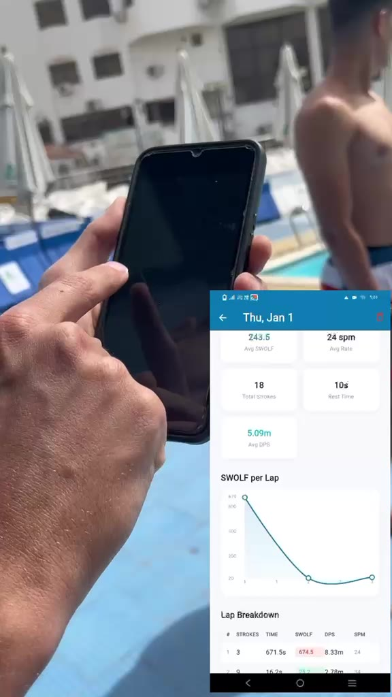

# SwimTrack


**Status: Prototype / MVP, dry-land tested only.**

SwimTrack is a wrist-worn swim training prototype. An ESP32-S2 board reads an
MPU-6500 motion sensor at 50 Hz, counts strokes and laps on the device, and
serves the results over its own WiFi access point. A Flutter app starts and
stops sessions, shows live numbers and keeps a session history on the phone.

The detection thresholds come from one dry-land session (arm movements at a
desk). Nothing in this repository has been tested in a pool.

## Demo

A poolside dry-land run: the swimmer wears the board on the wrist and swims the
strokes standing on the pool deck while the app records the session, then the
app shows strokes, stroke rate, laps and SWOLF per lap. The swimmer is not in
the water.

| Strokes on the deck | Session result in the app |
|---|---|
| [](docs/media/swimtrack-poolside-test.mp4) |  |

Full video (2 min): [`docs/media/swimtrack-poolside-test.mp4`](docs/media/swimtrack-poolside-test.mp4).

## Hardware

| Part | Used | Notes |
|---|---|---|
| Microcontroller | LOLIN S2 Mini (ESP32-S2) | Native USB, own WiFi access point for the app |
| Motion sensor | GY-6500 breakout (MPU-6500) | I2C on GPIO33/34, +/-8 g and +/-1000 dps at 50 Hz |
| Button and LED | BOOT button (GPIO0), on-board LED (GPIO15) | Start and stop, 3 s press resets |
| Power | USB | A LiPo and charger board are planned, not fitted |
| Capture rig | Second S2 Mini on the wrist plus an ESP32 receiver on USB | ESP-NOW, for recording labelled stroke data |

There is no printed wrist case yet. Wiring and pin use are in [`docs/hardware.md`](docs/hardware.md).

## Repository layout

| Folder | What it is |
|---|---|
| [`firmware/`](firmware/) | Device firmware for the LOLIN S2 Mini (PlatformIO, Arduino). Stroke and lap detection, session storage on flash, REST API, web dashboard. |
| [`data-collection/`](data-collection/) | Two-board ESP-NOW capture rig (wrist sender and USB receiver) and the Python tools that label, analyse and fit the stroke classifier. |
| [`app/`](app/) | Flutter companion app (Android is the target platform). |
| [`docs/`](docs/) | Hardware, REST API, algorithms and the bench test log. |

## Working now vs not built yet

| Area | Working now | Not built yet |
|---|---|---|
| Sensing | MPU-6500 over I2C at 50 Hz, EMA-filtered magnitude | Sensor calibration on the device firmware (only the capture rig calibrates) |
| Strokes | Stroke counting FSM with dynamic baseline, stroke rate | Validation against a counted pool swim |
| Stroke style | Decision tree that labels a stroke freestyle or backstroke | Breaststroke, butterfly; any accuracy figure that can be reproduced from this repo |
| Laps | Turn detection (gyro spike plus glide), minimum lap time guard, SWOLF and distance per stroke | Pool-tuned turn threshold (no turn data has been captured) |
| Rest | Rest detection from 1 s magnitude variance | Rest threshold from a clean still recording |
| Storage | Sessions saved as JSON on LittleFS, list, read and delete | Wall-clock timestamps (no RTC; IDs and times are uptime-based) |
| Connectivity | WiFi access point, REST API, browser dashboard | Bluetooth, cloud sync |
| App | Connect check, start and stop, live view, sync to SQLite, history with per-lap table and SWOLF chart, simulator mode | Accounts, export, iOS testing |
| Power | Runs from USB. Deep sleep after 5 min idle with no WiFi client is in the code but was not part of the bench tests | Battery monitoring (the code reads an ADC pin but the divider is not fitted), battery life figures, waterproof enclosure |

## Quick start

Each folder has its own README with details. The short version:

```bash
# Firmware: host unit tests and the device build
cd firmware
cp include/secrets.example.h include/secrets.h   # then set WIFI_AP_PASS
pio test -e native
pio run -e lolin_s2_mini

# Python tools
cd data-collection/swimtrack-tools
pip install -r requirements-dev.txt
python -m pytest -q
python analyse.py tests/fixtures/synthetic_session.csv --out-dir /tmp/swimtrack-out

# App
cd app
flutter pub get
flutter analyze
flutter test
```

## Tests

| Component | Command | What it covers |
|---|---|---|
| Firmware | `pio test -e native` | EMA filter, stroke FSM, stroke rate, stroke-style tree, turn FSM, lap guard, rest detection |
| Firmware | `pio run` in `firmware/` and both `data-collection/swimtrack-*` folders | The three boards compile |
| Python tools | `python -m pytest -q` | CSV loading, window features, threshold suggestions, classifier training and C++ export, collector derived columns |
| App | `flutter test` | Models and JSON parsing, SQLite repository (in-memory), REST client and sync against a fake device |

The same commands run in [`.github/workflows/ci.yml`](.github/workflows/ci.yml).

All test data is synthetic. The dry-land recording used to pick the current
thresholds is not part of this repository.

## Configuration that stays local

| File | Template | Holds |
|---|---|---|
| `firmware/include/secrets.h` | `secrets.example.h` | Access point SSID and password |
| `data-collection/swimtrack-sender/src/config_local.h` | `config_local.example.h` | Receiver MAC for unicast ESP-NOW (optional; default is broadcast) |

Both files are git-ignored. Without `secrets.h` the firmware builds with a
placeholder password and prints a compiler warning.

## License

MIT. See [LICENSE](LICENSE).

Source: <https://github.com/VINEX-Tech/swimtrack>

## Author

Designed and built by Abdel Rahman Mohamad EL-Sayed ([AbdelRahman-Madboly](https://github.com/AbdelRahman-Madboly) on GitHub) as a VINEX product.
