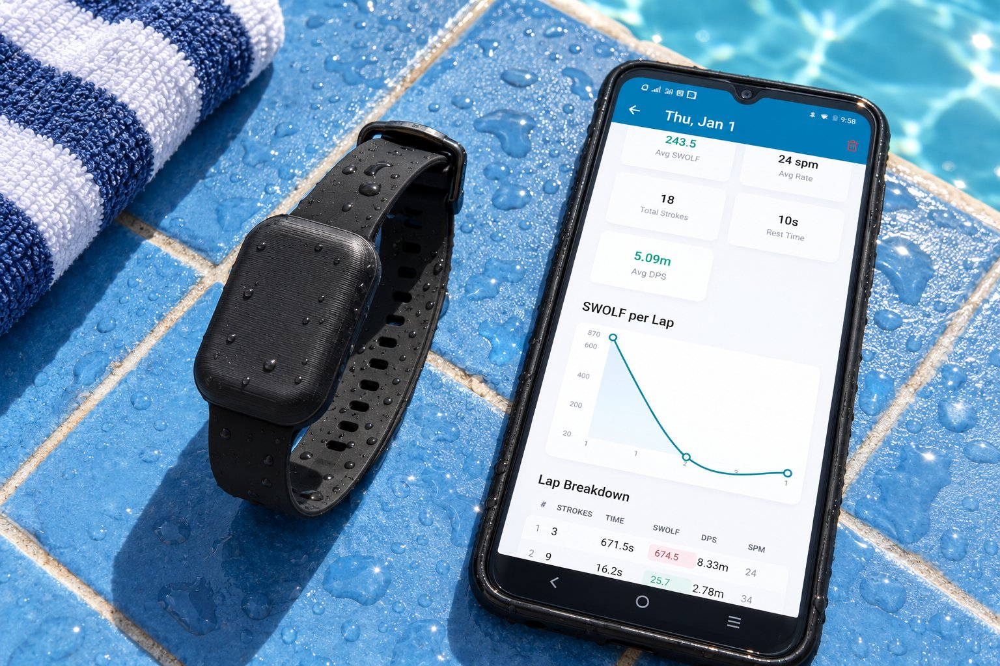
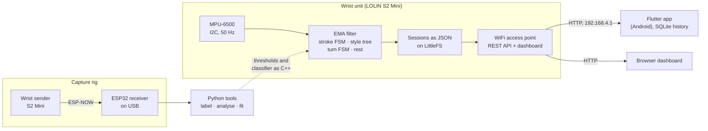
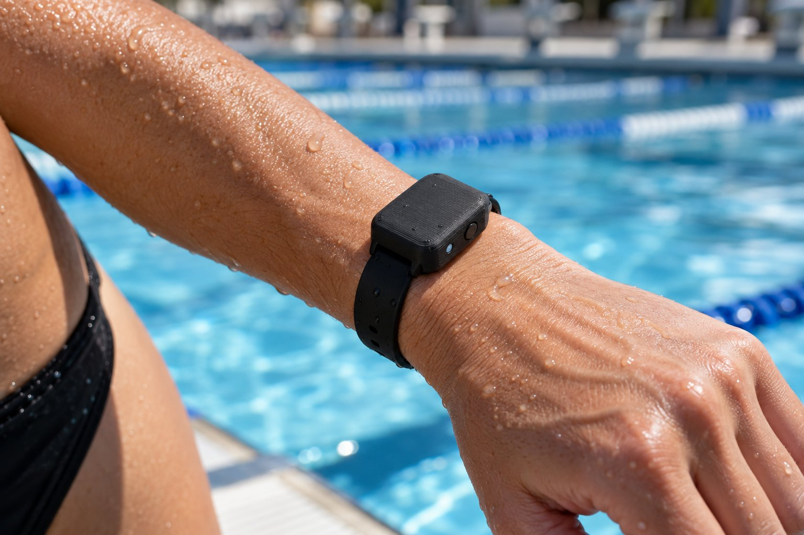

<div align="center">


# SwimTrack

**A wrist-worn swim training prototype: an ESP32-S2 counts strokes and laps on the device, and a Flutter app records the session.**

[](https://github.com/VINEX-Tech/swimtrack/actions/workflows/ci.yml)


[How it works](#how-it-works) · [Demo](#demo) · [Hardware](#hardware) · [Quick start](#quick-start) · [Status](#status) · [Roadmap](#roadmap)



<sub>Concept image of the planned band and app, not a photo of a built unit. The prototype board has no case yet.</sub>

</div>

## Why SwimTrack

Counting your own strokes and laps while you swim pulls your attention away from the swim, and the
count is easy to lose. SwimTrack puts the sensing, the detection and the session storage on one
small board on the wrist, serves the results over its own WiFi access point, and keeps every step,
from raw motion data to the app, in one open repository.

## Highlights

- **Detection on the device.** An MPU-6500 is read at 50 Hz. A stroke counting state machine with a
  dynamic baseline gives strokes and stroke rate; a turn detector (gyro spike plus glide) counts
  laps, with a minimum lap time guard, SWOLF and distance per stroke.
- **Stroke style.** A decision tree labels each stroke freestyle or backstroke.
- **No network needed.** The board runs its own WiFi access point with a REST API and a browser
  dashboard. See [`docs/api.md`](docs/api.md).
- **Sessions on the board and the phone.** Sessions are saved as JSON on the board's flash
  (LittleFS); the app syncs them to SQLite and shows a history with a per-lap table and a SWOLF
  chart. The app also has a simulator mode.
- **A rig for labelled data.** A two-board ESP-NOW capture rig and Python tools that label,
  analyse and fit the stroke classifier, and export it as C++.

## How it works



The detection steps are described in [`docs/algorithms.md`](docs/algorithms.md) and the device API
in [`docs/api.md`](docs/api.md).

## Demo

A poolside dry-land run. The swimmer wears the board on the wrist and swims the strokes standing on
the pool deck while the app records; the count goes up with each stroke. At the end the app shows
strokes, stroke rate, laps and SWOLF per lap. The swimmer is not in the water.

<table>
<tr><th>Strokes counted on the deck (18 s, click for the full video)</th><th>Session result in the app</th></tr>
<tr>
<td><a href="docs/media/swimtrack-poolside-test.mp4"></a></td>
<td></td>
</tr>
</table>

**[Watch the full video (2 min, MP4)](docs/media/swimtrack-poolside-test.mp4)**

## Pictures



<sub>Concept image of the planned band, not a photo of a built unit. The prototype board has no case yet.</sub>

## Hardware

| Part | Used | Notes |
|---|---|---|
| Microcontroller | LOLIN S2 Mini (ESP32-S2) | Native USB, own WiFi access point for the app |
| Motion sensor | GY-6500 breakout (MPU-6500) | I2C on GPIO33/34, +/-8 g and +/-1000 dps at 50 Hz |
| Button and LED | BOOT button (GPIO0), on-board LED (GPIO15) | Start and stop, 3 s press resets |
| Power | USB | A LiPo and charger board are planned, not fitted |
| Capture rig | Second S2 Mini on the wrist plus an ESP32 receiver on USB | ESP-NOW, for recording labelled stroke data |

There is no printed wrist case yet. Wiring and pin use are in [`docs/hardware.md`](docs/hardware.md).

## Quick start

Each folder has its own README with details. The short version:

```bash
git clone https://github.com/VINEX-Tech/swimtrack.git && cd swimtrack

# Firmware: host unit tests and the device build
cd firmware
cp include/secrets.example.h include/secrets.h   # then set WIFI_AP_PASS
pio test -e native
pio run -e lolin_s2_mini
cd ..

# Python tools
cd data-collection/swimtrack-tools
pip install -r requirements-dev.txt
python -m pytest -q
python analyse.py tests/fixtures/synthetic_session.csv --out-dir /tmp/swimtrack-out
cd ../..

# App
cd app
flutter pub get
flutter analyze
flutter test
```

| File | Template | Holds |
|---|---|---|
| `firmware/include/secrets.h` | `secrets.example.h` | Access point SSID and password |
| `data-collection/swimtrack-sender/src/config_local.h` | `config_local.example.h` | Receiver MAC for unicast ESP-NOW (optional; default is broadcast) |

Both files are git-ignored and stay local. Without `secrets.h` the firmware builds with a
placeholder password and prints a compiler warning.

## Status

**Prototype / MVP, dry-land tested only.** The detection thresholds come from one dry-land session
(arm movements at a desk). Nothing in this repository has been tested in a pool.

| Area | Working now | Not built yet |
|---|---|---|
| Sensing | MPU-6500 over I2C at 50 Hz, EMA-filtered magnitude | Sensor calibration on the device firmware (only the capture rig calibrates) |
| Strokes | Stroke counting FSM with dynamic baseline, stroke rate | Validation against a counted pool swim |
| Stroke style | Decision tree that labels a stroke freestyle or backstroke | Breaststroke, butterfly; any accuracy figure that can be reproduced from this repo |
| Laps | Turn detection (gyro spike plus glide), minimum lap time guard, SWOLF and distance per stroke | Pool-tuned turn threshold (no turn data has been captured) |
| Rest | Rest detection from 1 s magnitude variance | Rest threshold from a clean still recording |
| Storage | Sessions saved as JSON on LittleFS, list, read and delete | Wall-clock timestamps (no RTC; IDs and times are uptime-based) |
| Connectivity | WiFi access point, REST API, browser dashboard | Bluetooth, cloud sync |
| App | Connect check, start and stop, live view, sync to SQLite, history with per-lap table and SWOLF chart, simulator mode | Accounts, export, iOS testing |
| Power | Runs from USB. Deep sleep after 5 min idle with no WiFi client is in the code but was not part of the bench tests | Battery monitoring (the code reads an ADC pin but the divider is not fitted), battery life figures, waterproof enclosure |

## Roadmap

- [ ] Validate stroke counting against a counted pool swim
- [ ] Pool-tuned turn threshold from captured turn data
- [ ] Rest threshold from a clean still recording
- [ ] Sensor calibration in the device firmware
- [ ] Breaststroke and butterfly, with an accuracy figure that can be reproduced from this repo
- [ ] Wall-clock timestamps (RTC)
- [ ] Bluetooth and cloud sync
- [ ] Accounts, export and iOS testing in the app
- [ ] LiPo and charger fitted, battery monitoring with the ADC divider, battery life figures
- [ ] Printed, waterproof wrist enclosure

## Tests

The same commands run in [`.github/workflows/ci.yml`](.github/workflows/ci.yml).

| Component | Command | What it covers |
|---|---|---|
| Firmware | `pio test -e native` | EMA filter, stroke FSM, stroke rate, stroke-style tree, turn FSM, lap guard, rest detection |
| Firmware | `pio run` in `firmware/` and both `data-collection/swimtrack-*` folders | The three boards compile |
| Python tools | `python -m pytest -q` | CSV loading, window features, threshold suggestions, classifier training and C++ export, collector derived columns |
| App | `flutter test` | Models and JSON parsing, SQLite repository (in-memory), REST client and sync against a fake device |

All test data is synthetic. The dry-land recording used to pick the current thresholds is not part
of this repository.

## Repository layout

| Folder | What it is |
|---|---|
| [`firmware/`](firmware/) | Device firmware for the LOLIN S2 Mini (PlatformIO, Arduino). Stroke and lap detection, session storage on flash, REST API, web dashboard. |
| [`data-collection/`](data-collection/) | Two-board ESP-NOW capture rig (wrist sender and USB receiver) and the Python tools that label, analyse and fit the stroke classifier. |
| [`app/`](app/) | Flutter companion app (Android is the target platform). |
| [`docs/`](docs/) | Hardware, REST API, algorithms and the bench test log. |

## License

MIT. See [LICENSE](LICENSE).

## Author

Designed and built by **Abdel Rahman Mohamad EL-Sayed** ([@AbdelRahman-Madboly](https://github.com/AbdelRahman-Madboly)) as a [VINEX](https://github.com/VINEX-Tech) product.
